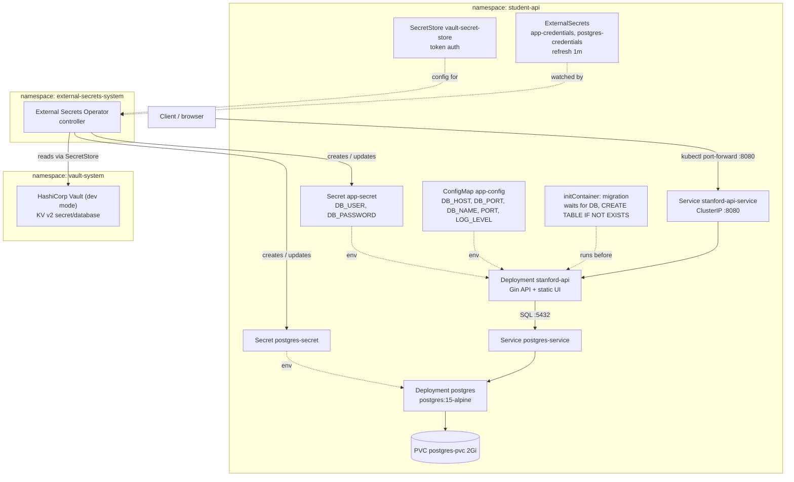
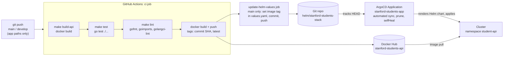
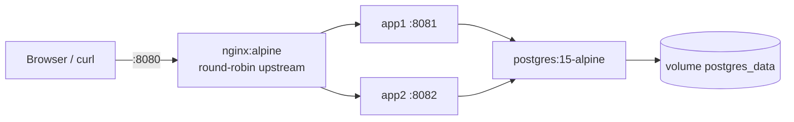

# Student Enrollment API — from `go run` to GitOps on Kubernetes

A Go (Gin) REST API backed by PostgreSQL, taken through the full delivery lifecycle: unit tests and linting, containerisation, a load-balanced Docker Compose stack, Kubernetes with Vault-sourced secrets via External Secrets Operator, a Helm chart, and continuous delivery with GitHub Actions and ArgoCD.

[](https://github.com/johntoby/stanford-students-project/actions/workflows/ci.yml)
[](go.mod)
[](LICENSE)

> Built for the One2N SRE Bootcamp. "Stanford" is the exercise's fictional client name only — this project has no affiliation with Stanford University.

---

## Contents

- [Overview](#overview)
- [Architecture](#architecture)
- [Tech stack](#tech-stack)
- [Repository structure](#repository-structure)
- [Getting started (local)](#getting-started-local)
- [Deploying to Kubernetes](#deploying-to-kubernetes)
- [CI/CD pipeline](#cicd-pipeline)
- [API reference](#api-reference)
- [Configuration](#configuration)
- [Design decisions and trade-offs](#design-decisions-and-trade-offs)
- [Troubleshooting](#troubleshooting)
- [What I would do next in production](#what-i-would-do-next-in-production)
- [License](#license)

## Overview

**Problem.** The bootcamp brief: build a versioned CRUD API for student records (create, list, get, update, delete) with a health check, meaningful leveled logs, unit tests, schema migrations and environment-based configuration — then progressively operate it the way a real service would be operated as it grows.

**What this repository demonstrates**

| Area | Implementation |
|---|---|
| Service design | Versioned routes (`/api/v1`), repository interface over `database/sql`, request validation, dependency-aware `/healthcheck` |
| Testing and quality | Handler unit tests with `testify` mocks (no DB needed), `golangci-lint` with gofmt/goimports/govet/staticcheck/revive/gocritic |
| Containers | Multi-stage Docker build; Compose stack with two API replicas behind Nginx and a health-gated startup order |
| Kubernetes | Deployments, Services, ConfigMaps, PVC, init-container migrations, liveness/readiness probes, resource requests/limits, node-pool placement via `nodeSelector` |
| Secrets | HashiCorp Vault (KV v2) as source of truth, synced into Kubernetes Secrets by External Secrets Operator |
| Packaging | Helm chart `helm/stanford-students-stack` |
| Delivery | GitHub Actions builds, tests, lints and pushes an image tagged with the commit SHA, then writes the tag back to the chart; ArgoCD auto-syncs the chart to the cluster |

## Architecture

### Runtime on Kubernetes



- Workloads are pinned to node pools by label: API pods to `type=application`, PostgreSQL to `type=database`, Vault, ESO and ArgoCD to `type=dependent_services`.
- The schema is created idempotently by the init container (and again by the app at startup), so pods can roll in any order.
- There is no Ingress in the current manifests; the Service is `ClusterIP` and is reached with `kubectl port-forward` (or by patching it to `LoadBalancer`).
- **Where Vault/ESO is wired today:** the raw manifests in [`k8s/`](k8s/) (deployed by [`deploy.sh`](deploy.sh)) create the SecretStore and ExternalSecrets shown above. The Helm chart that ArgoCD syncs currently renders `app-secret` and `postgres-secret` directly from [`templates/secrets.yaml`](helm/stanford-students-stack/templates/secrets.yaml); its `vault` / `external-secrets` values are placeholders. Moving the chart onto ESO is the first item on the [roadmap](#what-i-would-do-next-in-production).

### Delivery flow



### Local stack (Docker Compose)



Compose starts the API only after PostgreSQL passes `pg_isready`, and Nginx only after both API containers pass their `/healthcheck`.

## Tech stack

| Layer | Technology |
|---|---|
| Language / framework | Go 1.21, Gin, `lib/pq`, `godotenv` |
| Database | PostgreSQL 15 |
| Testing / linting | `testing` + `testify` (mocks, assertions), `golangci-lint` |
| Containers | Docker (multi-stage build), Docker Compose, Nginx |
| Orchestration | Kubernetes, Helm 3 |
| Secrets | HashiCorp Vault (KV v2), External Secrets Operator v0.9 |
| CI/CD | GitHub Actions, Docker Hub, ArgoCD |
| Local VM (optional) | Vagrant + VirtualBox (Ubuntu 22.04) |

## Repository structure

```text
.
├── main.go                    # Entry point: config, DB connect, migrations, router
├── config/                    # Environment-based configuration
├── db/                        # Connection setup and startup migration
├── handlers/                  # HTTP handlers + unit tests (mocked repository)
├── middleware/                # Request logging with level by status code
├── models/                    # Student model and PostgreSQL repository
├── router/                    # Route table and static UI
├── frontend/                  # Minimal HTML/JS UI served by the API
├── migrations/init.sql        # Schema + seed row
├── postman/                   # Postman collection
├── Dockerfile                 # Multi-stage image build
├── docker-compose.yml         # Postgres + 2 API replicas + Nginx
├── nginx.conf                 # Upstream load balancing for Compose
├── Makefile                   # Build, test, lint and local-stack targets
├── .github/workflows/ci.yml   # CI: build, test, lint, push image, bump chart tag
├── k8s/                       # Raw manifests: Vault, ESO, database, application
├── helm/
│   ├── stanford-students-stack/   # Helm chart synced by ArgoCD
│   └── deploy.sh, cleanup.sh      # Direct Helm install / uninstall
├── argocd/                    # ArgoCD Application, repo secret, server tweaks
├── deploy.sh                  # End-to-end raw-manifest deploy (Vault + ESO + app)
├── fix-vault-secrets.sh, quick-vault-check.sh   # Vault/ESO recovery helpers
├── Vagrantfile, vagrant-setup.sh                # Optional local VM
└── *.md                       # Deep-dive guides (see links below)
```

## Getting started (local)

**Prerequisites:** Docker with Compose v2, GNU Make. Go 1.21+ only if you run the API outside a container. [`install-prerequisites.sh`](install-prerequisites.sh) installs these on Ubuntu/Debian.

### Full stack with Docker Compose

```bash
git clone https://github.com/johntoby/stanford-students-project.git
cd stanford-students-project

make run-api          # builds the image and starts Postgres, 2 API replicas and Nginx
# or: docker compose up --build -d

curl http://localhost:8080/healthcheck
curl http://localhost:8080/api/v1/students
# UI:  http://localhost:8080
```

Stop with `make stop-all`, or `make clean` to also remove volumes and images.

### API on the host, database in Docker

```bash
make start-db         # postgres:15-alpine on localhost:5432
cp .env.example .env  # defaults match the container above
go run .              # creates the table on startup, listens on :8080
```

### Tests and lint

```bash
make test             # go test -v ./...
make lint             # formats, then installs and runs golangci-lint v1.54.2
```

### Make targets

| Target | Purpose |
|---|---|
| `build` | `go mod tidy` + `go build ./...` |
| `test` | Run unit tests |
| `format` | `go fmt` + `goimports` |
| `lint` | Format, then `golangci-lint run` |
| `start-db` / `migrate` | Start a standalone Postgres container / create the schema in it |
| `build-api` | Build the Docker image |
| `run-api` / `start-all` | Start the Compose stack (Postgres, app1, app2, Nginx) |
| `status`, `logs`, `logs-nginx`, `debug` | Inspect the Compose stack |
| `stop-all` / `clean` | Stop the stack / also remove volumes and images |

A [Postman collection](postman/stanford_students_api.json) covers every endpoint.

## Deploying to Kubernetes

**Prerequisites:** a cluster, `kubectl`, Helm 3. Nodes must carry the labels the manifests select on, otherwise pods stay `Pending`:

```bash
kubectl label node <app-node>     type=application
kubectl label node <db-node>      type=database
kubectl label node <infra-node>   type=dependent_services
```

| Path | Command | What it deploys |
|---|---|---|
| GitOps (ArgoCD) | Install ArgoCD, then `kubectl apply -f argocd/repository.yaml -f argocd/application.yaml` | Helm chart from `HEAD`, auto-synced with prune and self-heal. See [argocd/README.md](argocd/README.md). |
| Helm directly | `cd helm && ./deploy.sh` | Same chart via `helm install`. See [helm/README.md](helm/README.md). |
| Raw manifests with Vault + ESO | `./deploy.sh` | Vault (dev mode), ESO, SecretStore/ExternalSecrets, Postgres, API. Builds and pushes the image first, so it needs Docker Hub access. See [k8s/README.md](k8s/README.md). |

Access the API:

```bash
kubectl port-forward -n student-api svc/stanford-api-service 8080:8080
curl http://localhost:8080/healthcheck
```

## CI/CD pipeline

Defined in [`.github/workflows/ci.yml`](.github/workflows/ci.yml).

- **Triggers:** pushes to `main`/`develop` and pull requests to `main`, filtered to application paths (Go code, `Dockerfile`, `Makefile`, Compose, lint config, frontend); also manual `workflow_dispatch`.
- **`ci` job:** set up Go 1.21 with module cache, `make build-api`, `make test`, `make lint`, log in to Docker Hub, build and push `<user>/stanford-students-api:<commit-sha>` and `:latest`.
- **`update-helm-values` job (main only):** rewrites `app.image.tag` in `helm/stanford-students-stack/values.yaml` to the new SHA and pushes the commit. Because `helm/` is outside the trigger paths, this does not re-trigger CI.
- **CD:** ArgoCD watches the repository, sees the new tag and rolls the Deployment. Rollback is a `git revert` of the tag bump.
- **Required secrets:** `DOCKER_USERNAME`, `DOCKER_PASSWORD`, `MY_GITHUB_TOKEN` (a token with write access to push the tag bump).

## API reference

Base URL: `http://localhost:8080`

| Method | Path | Success | Errors |
|---|---|---|---|
| `GET` | `/healthcheck` | `200` `{status, message, database, total_students}` | `503` if the database is unreachable |
| `POST` | `/api/v1/students` | `201` created student | `400` validation, `500` |
| `GET` | `/api/v1/students` | `200` array of students | `500` |
| `GET` | `/api/v1/students/:id` | `200` student | `400` invalid id, `404`, `500` |
| `PUT` | `/api/v1/students/:id` | `200` updated student | `400`, `404`, `500` |
| `DELETE` | `/api/v1/students/:id` | `200` `{message}` | `400`, `404`, `500` |
| `GET` | `/` | Web UI (static files) | |

Validation: `first_name`, `last_name`, `email` (valid format), `major` are required; `gpa` must be 0–4. Dates are RFC 3339.

```bash
curl -X POST http://localhost:8080/api/v1/students \
  -H 'Content-Type: application/json' \
  -d '{"first_name":"Ada","last_name":"Lovelace","email":"ada@example.com",
       "major":"Computer Science","gpa":3.9,
       "enrollment_date":"2024-09-01T00:00:00Z","graduation_year":2028}'
```

## Configuration

All configuration comes from environment variables. A `.env` file is loaded if present (see [`.env.example`](.env.example)).

| Variable | Default | Notes |
|---|---|---|
| `DB_HOST` | `localhost` | |
| `DB_PORT` | `5432` | |
| `DB_USER` | `postgres` | From a Kubernetes Secret in-cluster |
| `DB_PASSWORD` | `postgres` | From a Kubernetes Secret in-cluster |
| `DB_NAME` | `stanford_students` | |
| `PORT` | `8080` | HTTP listen port |
| `LOG_LEVEL` | `info` | `debug`/`info` log every request; 4xx logged as `WARN` unless `error`; 5xx always logged as `ERROR` |

The defaults are development values for local use only.

## Design decisions and trade-offs

- **Vault + External Secrets Operator.** Credentials live outside Git and the app consumes plain Kubernetes Secrets, so there is no Vault SDK in the code and the same image runs under Compose and Kubernetes. Cost: two more components to run; here Vault runs in dev mode with a static token, which is acceptable only for a lab.
- **GitOps with ArgoCD.** Git is the desired state; drift is self-healed and removed resources are pruned. CI writing the image tag back gives an audit trail and makes rollback a revert. Cost: CI needs a write token, and bot commits land on `main`.
- **Immutable SHA tags.** The chart pins the commit SHA, so every rollout maps to an exact commit. `latest` is also pushed but only used by the raw `k8s/` manifests.
- **Repository interface.** Handlers depend on `StudentRepository`, so they are unit-tested against mocks without a database.
- **Idempotent schema creation in several places** (init container, app startup, Postgres init script). Robust to start order, but the SQL is duplicated; a versioned migration tool is the right next step.
- **Dependency-aware health check.** `/healthcheck` queries the database, so readiness reflects whether a pod can actually serve. The same endpoint is used for liveness, which means a database outage would restart every API pod; these should be split.
- **Node pools via `nodeSelector`.** Keeps the database and platform services off application nodes. Simple, but needs labelled nodes up front; taints/tolerations or affinities would be more flexible.

## Troubleshooting

- Vault / ESO sync problems: [VAULT_ESO_TROUBLESHOOTING.md](VAULT_ESO_TROUBLESHOOTING.md), plus [`quick-vault-check.sh`](quick-vault-check.sh) and [`fix-vault-secrets.sh`](fix-vault-secrets.sh).
- Container registry setup for CI: [docker-setup.md](docker-setup.md).
- Running everything inside a Vagrant VM: [vagrant-commands.md](vagrant-commands.md).
- Earlier Kubernetes iteration (Nginx + Ingress): [KUBERNETES-DEPLOYMENT.md](KUBERNETES-DEPLOYMENT.md).

## What I would do next in production

This is a learning project; these are the gaps I would close before running it for real.

- **Secrets:** template `SecretStore`/`ExternalSecret` in the Helm chart instead of static `secrets.yaml`; run Vault in HA with real storage and the Kubernetes auth method instead of a dev-mode root token.
- **Probes and shutdown:** separate liveness from readiness; add graceful shutdown on `SIGTERM` and explicit DB connection-pool limits.
- **Database:** a managed PostgreSQL (or a StatefulSet operator) with backups, and versioned migrations (e.g. `golang-migrate`) run as a Job.
- **Edge:** an Ingress with TLS instead of port-forwarding; restrict the currently open CORS policy.
- **Observability:** structured JSON logs, a Prometheus `/metrics` endpoint, SLO-based alerts and tracing — none of which exist yet.
- **CI hardening:** lint and test before building, build the image once with layer caching, scan it (e.g. Trivy), stop pushing `latest`, skip registry pushes on pull requests, move to GHCR with `GITHUB_TOKEN`, and upgrade Go and action versions.
- **Image:** a distroless or Alpine runtime running as non-root instead of `ubuntu:22.04` as root.
- **Resilience:** PodDisruptionBudget and HorizontalPodAutoscaler for the API.

## License

[MIT](LICENSE) © 2025 John Idowu
